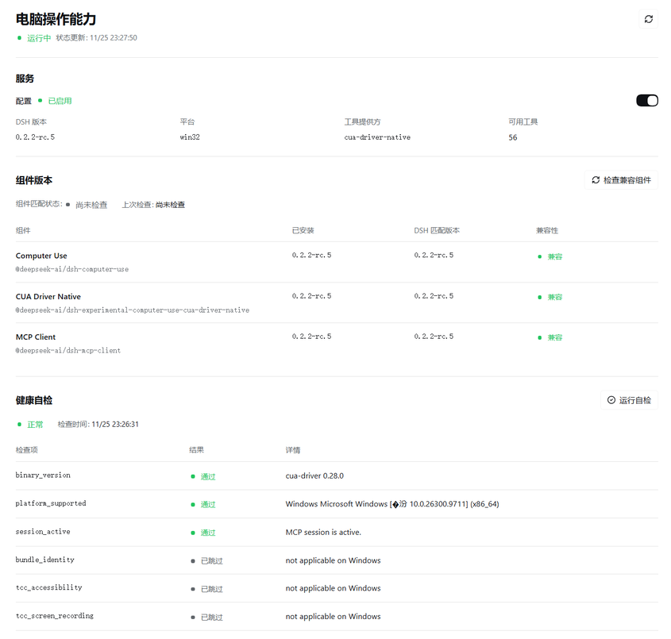

# DSH 电脑操作能力激活与管理

为 DSH 自带的 computer-use（电脑操作）能力提供开关、组件检查和自检的管理页面。

[](https://github.com/jwhs648/dsh-computer-use-manager/releases)
[](https://github.com/jwhs648/dsh-computer-use-manager/actions/workflows/tests.yml)
[](https://github.com/jwhs648/dsh-computer-use-manager/actions/workflows/hosts.yml)
[](LICENSE)


本插件**不带**独立的电脑操作引擎。桌面操作由 DSH 官方 computer-use 组件和 Cua Driver Native 完成，本插件负责把它们检查齐、打开，并显示运行状态。社区插件，非 DeepSeek 或 Cua 官方发行。



## 快速开始

1. 从 [最新 Release](https://github.com/jwhs648/dsh-computer-use-manager/releases/tag/v0.2.0-beta.2) 下载 [`local-dsh-computer-use-manager-0.2.0-beta.2.tgz`](https://github.com/jwhs648/dsh-computer-use-manager/releases/download/v0.2.0-beta.2/local-dsh-computer-use-manager-0.2.0-beta.2.tgz)，可用同页的 `SHA256SUMS.txt` 核对。
2. 在 DSH Desktop 打开 **插件 → 添加插件**，填入安装包在 DSH 所在机器上的绝对路径（不加引号），安装并启用。
3. 打开侧栏的 **电脑操作能力**，打开开关。组件缺失时按页面提示补齐，启用后查看自检结果。

已装旧版时直接安装新包即可升级。也可以退出 DSH 后用命令行安装：

```powershell
dsh plugin --profile desktop add "C:\path\to\local-dsh-computer-use-manager-0.2.0-beta.2.tgz"
```

> 首次安装不会自动开启电脑操作，两个底层组件默认关闭。远程浏览器那台电脑上的路径不能直接用于 DSH 主机。

## 开启前后有什么区别

变化的是 AI 能调用的工具，不是模型本身。代码、文件、终端等原有工具不受影响。

| 场景 | 未开启 | 开启且驱动就绪后 |
| --- | --- | --- |
| 看应用界面 | 只能靠你提供截图 | 枚举应用和窗口，读取控件树，按需截图 |
| 操作应用 | 无法点击或输入（仍可用终端等方式） | 点击、双击、滚动、拖动、输入文字、按键和快捷键 |
| 管理应用与窗口 | 无 | 启动应用、调整窗口位置和大小 |
| 操作浏览器页面 | 只有已配置的搜索、抓取工具 | 在已授权的浏览器连接中读页面、点击、填表、上传下载 |
| 剪贴板 | 无 | 读写文本，以及支持的图像或文件引用 |

在 Windows x64 + DSH `0.2.2-rc.5` 上启用后显示 **56 个原生工具**，实际数量以管理页为准，会随宿主版本变化。

可以这样提要求：

- “找到某某应用的窗口，读取当前界面；有报错就截图帮我分析。”
- “打开某某应用的设置，看看当前选项，改之前先告诉我。”
- “在我已授权的浏览器页面填写这些内容，提交前停下让我确认。”

桌面工具操作的是**运行 DSH 的那台电脑**。开启不等于绕过登录、验证码、系统权限或 DSH 审批。

## 插件本身做什么

| 入口 | 行为 |
| --- | --- |
| 启用开关 | 本地检查组件，就绪后启用并自检；缺包时给出补齐方式 |
| 运行状态 | 区分保存的配置、实际提供方、可用工具数和是否需要重启 |
| 检查兼容组件 | 查询与当前 DSH 精确匹配的官方组件（不是追最新版） |
| 安装匹配版本 | 只安装固定的三个官方组件，不接受任意包名或版本 |
| 健康自检 | 只读取驱动诊断，不截图、不操作桌面 |

界面支持中文、英文和窄屏。停用电脑操作后管理页仍可访问。

## 兼容性

| 项目 | 说明 |
| --- | --- |
| 声明范围 | Windows x64，DSH `>=0.2.2-rc.3 <0.3.0-0` |
| 页面内一键补装 | 仅 `0.2.2-rc.3`；其他版本显示对应的 `dsh plugin` 命令 |
| 已验证 | `rc.3`、`rc.4`、`rc.5` 宿主包；`check-hosts` 另在 `0.2.3-alpha.2` 上通过；本机 DSH Desktop `0.2.2-rc.5` 实装 |
| CI | 每次推送和每周一针对 npm 上最新 RC 验证加载，最新 alpha 作预警 |
| 尚未实测 | 第二台机器首装；真实的 `0.2.2` 正式版和 `0.2.3`；macOS、Linux |

## 安全边界

- 开关写入配置，影响当前 DSH 配置下的**所有会话**。
- 不自动授予系统权限，不绕过 DSH 审批，不自动重启 DSH。
- 组件安装锁定当前宿主的精确版本，并禁用安装脚本。
- 发现未结束的官方安装操作时直接停止，不猜测、不覆盖。
- 失败时只撤销本次操作自己做的改动；无法确认时如实报告需要修复或重启，不假装恢复成功。

安装、取消、HMR 和恢复的详细行为见 [开发者说明](docs/DEVELOPMENT.md)。

## 更新与卸载

本插件来自本地 tarball，不会通过 DSH 的 Versions 页面自动升级；“检查兼容组件”只管三个官方组件，不更新本插件。

卸载管理插件不会删除单独安装的电脑操作组件。建议先关闭电脑操作能力，再卸载。

## 版本历史

| 版本 | 支持的 DSH | 状态 |
| --- | --- | --- |
| [0.2.0-beta.2](https://github.com/jwhs648/dsh-computer-use-manager/releases/tag/v0.2.0-beta.2) | `>=0.2.2-rc.3 <0.3.0-0` | 当前预发行版 |
| [0.2.0-beta.1](https://github.com/jwhs648/dsh-computer-use-manager/releases/tag/v0.2.0-beta.1) | `>=0.2.2-rc.3 <0.2.2` | DSH `0.2.2` 正式版上不再加载，请升级 |
| [0.1.0-alpha.4](https://github.com/jwhs648/dsh-computer-use-manager/releases/tag/v0.1.0-alpha.4) | `0.2.2-rc.3` | 旧版 |
| [0.1.0-alpha.3](https://github.com/jwhs648/dsh-computer-use-manager/releases/tag/v0.1.0-alpha.3) | `0.2.2-rc.2` | 旧版 |
| [0.1.0-alpha.2](https://github.com/jwhs648/dsh-computer-use-manager/releases/tag/v0.1.0-alpha.2) | `0.2.2-rc.1` | 旧版 |
| 0.1.0-alpha.1 | — | 有已知缺陷，不建议使用 |

完整变更见 [CHANGELOG](CHANGELOG.md)。

## 开发与反馈

在源码仓库运行测试（不要在精简发行包里运行）：

```powershell
node --test core.test.js api.test.js package.test.js
```

浏览器回归入口是 `verification/run-ui.mjs`，需要开发依赖和 Windows Edge，详见 [开发者说明](docs/DEVELOPMENT.md)。

[提交问题](https://github.com/jwhs648/dsh-computer-use-manager/issues)时请附上 DSH 版本、操作系统、安装方式和脱敏后的错误；不要上传密钥、完整配置、会话内容或未裁剪的桌面截图。

## 许可证

原创代码和插件图标采用 [MIT License](LICENSE)。内嵌控件图标的 Lucide / Feather 归属见 [第三方声明](THIRD_PARTY_NOTICES.md)。DSH、Cua Driver 等组件保留各自的许可证。
