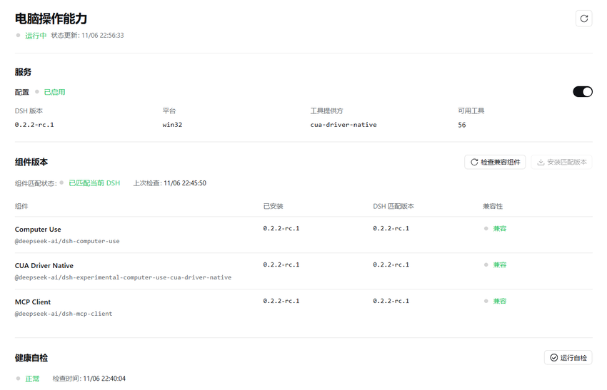

# DSH 电脑操作能力

**在 DeepSeek Harness 中集中管理电脑操作能力：检查组件、确认安装、启用与健康自检。**

Computer Use Capability Manager for DeepSeek Harness. 社区插件，非 DeepSeek 或 Cua 官方发行组件。

[](LICENSE)
[](https://github.com/jwhs648/dsh-computer-use-manager/releases/tag/v0.1.0-alpha.1)
[](#兼容性与验证范围)

[下载测试版](https://github.com/jwhs648/dsh-computer-use-manager/releases/tag/v0.1.0-alpha.1) · [安装](#安装) · [更新记录](CHANGELOG.md) · [问题反馈](https://github.com/jwhs648/dsh-computer-use-manager/issues)



> **预发布测试版**：已在 Windows x64 + DSH Desktop `0.2.2-rc.1` 验证。首次补全安装与异常恢复已通过隔离测试，尚未在第二台实机完成首装验证。请勿将其视为所有平台、所有 DSH 版本都可用的稳定版。

## 能做什么

| 入口 | 行为 |
| --- | --- |
| 启用开关 | 自动检查本地组件；需要安装时请求确认，随后继续启用并自检 |
| 运行状态 | 区分保存的配置、实际工具提供方、可用工具和需要重启的状态 |
| 检查兼容组件 | 查询与当前 DSH 精确匹配的官方组件，不是最新版检测 |
| 安装匹配版本 | 只安装固定的三个组件，不接受任意包名或版本 |
| 健康自检 | 读取原生驱动诊断，不发送桌面操作或截图 |

界面支持中文、英文及窄屏布局。管理页面独立于可选驱动，停用电脑操作能力后仍可访问。

## 安装

### 推荐：DSH 插件页面

1. 在 DSH Desktop 中打开 **插件 → 添加插件**。
2. 在 **包名或地址** 中粘贴下面的发行包地址。
3. 阅读第三方插件的信任提示，点击 **安装**；成功后点击 **立即启用**。
4. 进入侧栏的 **电脑操作能力**，打开启用开关。组件缺失时，确认 **安装并启用**，等待检查完成。

```text
https://github.com/jwhs648/dsh-computer-use-manager/releases/download/v0.1.0-alpha.1/dsh-computer-use-manager-0.1.0-alpha.1.tgz
```

需要重启时，页面会明确提示，请手动重启 DSH。首次启用管理插件不会直接启动电脑操作驱动，两个底层组件默认关闭。

**下载到本地后安装**：也可以先从 Release 下载 `.tgz`，将其在 **DSH 所在机器** 上的绝对路径填入“包名或地址”。输入路径时不要添加引号；远程浏览器电脑上的路径不可直接用于 DSH 主机。可同时下载 `SHA256SUMS.txt` 校验文件完整性。

<details>
<summary>命令行安装与 Git 来源安装</summary>

先启动 Desktop 一次，初始化配置。使用 **Desktop 安装的 `dsh` 命令**；为确保变更完整应用，先退出 DSH，执行后再打开。普通 npm 安装的 CLI 不能管理保留的 `desktop` 配置。

```powershell
dsh plugin --profile desktop add "https://github.com/jwhs648/dsh-computer-use-manager/releases/download/v0.1.0-alpha.1/dsh-computer-use-manager-0.1.0-alpha.1.tgz"
```

源码安装也受支持，但需要 Git 与对应网络访问，优先推荐上面的固定发行包：

```powershell
dsh plugin --profile desktop add "github:jwhs648/dsh-computer-use-manager#v0.1.0-alpha.1"
```

首次 CLI 安装会自动选择新声明的 bundle；没有热重载时需要重新打开 DSH。

</details>

## 开启流程

```text
点击开关 → 检查本地组件 → 必要时确认并安装 → 启用 → 等待驱动就绪 → 自检
```

- 组件已安装且兼容时，跳过联网查询与下载。
- 缺失或不兼容时，先验证当前 DSH 的匹配版本，再弹出安装确认；确认五分钟有效、仅可使用一次。
- 取消确认不会安装或继续启用。安装失败、启动失败、需要重启和自检异常会分别显示，不会一律显示为成功。
- 关闭页面后，已确认的后台操作继续执行；再次进入可以查看进度。

## 兼容性与验证范围

| 项目 | 当前范围 |
| --- | --- |
| 实机验证 | Windows x64、DSH Desktop `0.2.2-rc.1` |
| 声明的宿主 API 范围 | `>=0.2.2-rc.1 <0.3.0`，不代表区间内每个版本均已实测 |
| 原生驱动 | Cua Driver Native，随 DSH 匹配组件解析 |
| 自动化验证 | 121 项后台/API 测试、19 个浏览器场景 |
| 浏览器布局 | 1280 / 390 / 320 像素，中英文 |
| 尚未实测 | 第二台机器首装、macOS、Linux、其他 DSH 版本 |

开启能力仍受操作系统权限、DSH 审批和当前宿主配置约束。`0.3.x` 等不兼容宿主版本需要先更新本插件。

## 安全与恢复边界

- 安装、启用和停用影响 **当前 DSH 配置下的所有会话**。请先确认没有其他会话依赖正在调整的能力。
- 本插件不会自动授予系统权限、绕过 DSH 审批或自动重启 DSH；管理页的自检不会操作桌面。
- 只管理固定的三个官方组件，目标始终为当前运行的 DSH 版本，安装时禁用包脚本。
- 安装失败会尝试恢复原依赖；启动失败会尝试恢复之前的启用状态。已观察到的外部配置变更会保留。官方接口没有跨客户端事务，恢复不是绝对原子保证。
- 普通重启会保留配置；完整 Desktop 恢复可能取消自定义 bundle 的选择，此时需在插件页重新启用管理插件。

## 更新与卸载

**插件本身更新**：这是 GitHub/tarball 来源插件，不通过内置 Versions 页面自动升级。先在插件页卸载本管理插件，再安装新的发行包；不要把“检查兼容组件”当作管理插件的更新入口。

**卸载**：在插件页找到本管理插件，点击 **卸载** 并确认。先关闭电脑操作能力，可以更清楚地观察停用结果。卸载管理插件不会自动移除之前单独安装的三个电脑操作组件。

<details>
<summary>命令行卸载</summary>

先完全退出 DSH，再执行并重新打开：

```powershell
dsh plugin --profile desktop remove @local/dsh-computer-use-manager
```

</details>

## 开发与反馈

从 **源码仓库** 运行测试，不要在已安装的精简发行包中执行：

```powershell
node --test core.test.js api.test.js
```

后台测试不需要安装宿主组件。浏览器演示测试需要 Node.js 24、pnpm 11 和安装在默认位置的 Windows Edge：

```powershell
cd verification
pnpm install --frozen-lockfile
node run-ui.mjs
```

更多接口与恢复说明见 [开发者说明](docs/DEVELOPMENT.md)。反馈时请提供 DSH 版本、操作系统、安装方式及已脱敏的错误；不要上传密钥、完整配置、会话内容或未裁剪的桌面截图。

## 许可证

本插件原创代码采用 [MIT License](LICENSE)。DSH、Cua Driver 和其他第三方组件保留各自许可证；本项目不代表这些项目的官方支持或授权。
